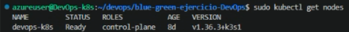
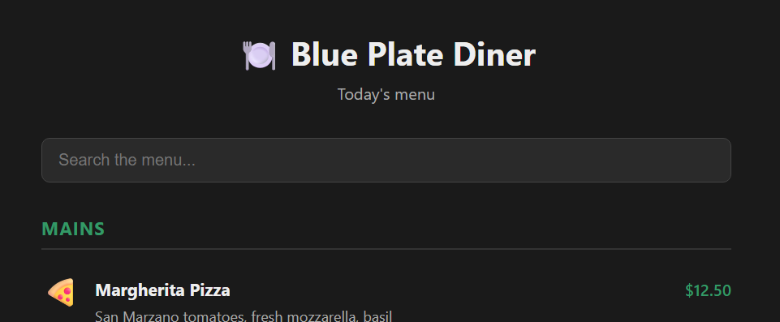
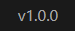
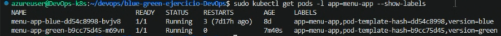
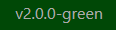
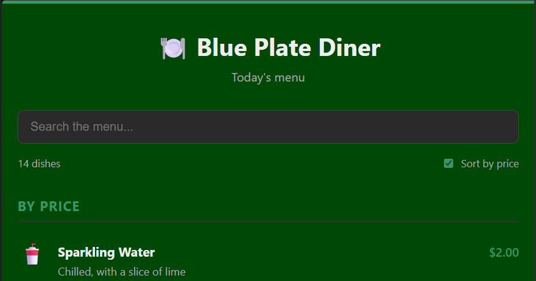

# Entregable 1: Aplicación en Kubernetes

Andrés Christoff - Luis Gaudiano - Sebastián Freire
## Resumen del proyecto

Desplegamos una aplicación web contenerizada en un cluster de Kubernetes, aplicando la estrategia **blue/green** entre dos versiones de la misma app.

La aplicación es **Blue Plate Diner**, construida con **React + Vite**: el menú de un restaurante con precios y una barra de búsqueda que filtra platos por nombre, descripción o categoría. El footer muestra un string de versión, lo que sirve para distinguir a simple vista si estamos viendo *blue* o *green*.

## Stack utilizado

- **Ubuntu (VM):** sistema operativo del servidor.
- **k3s:** distribución liviana de Kubernetes. Trae el cluster completo en un solo binario, junto con su propio runtime de contenedores basado en containerd.
- **Docker:** build de la imagen de la aplicación a partir del Dockerfile.
- **kubectl:** cliente para interactuar con el cluster, se instala junto con k3s.
- **Git:** control de versiones y obtención del código.

Usamos una VM en Azure en vez de correr todo localmente porque las computadoras del grupo no tenían la RAM suficiente para levantar el cluster de forma estable, por eso figura Ubuntu (VM) en el stack en lugar de un sistema operativo local.

Elegimos k3s por sobre alternativas como minikube porque corre directo sobre la VM como servicio del sistema, sin capa de virtualización adicional, consume muchos menos recursos, y es apto para producción y no solo para desarrollo local. El mismo proceso es escalable a un cluster real realizando cambios mínimos.

El aprovisionamiento de esa VM es un paso previo y externo al alcance técnico del curso, así que no se detalla acá: documentamos el proceso a partir de la VM ya disponible y accesible por SSH.

## Proceso de implementación y reproducibilidad

**1. Actualizar el sistema.**

```bash
sudo apt update
sudo apt upgrade
```

**2. Instalar k3s.**

```bash
curl -sfL https://get.k3s.io | sh -
```

Con un solo comando queda corriendo el cluster como servicio del sistema, y `kubectl` instalado automáticamente. Se puede confirmar con `sudo kubectl get nodes`: el nodo tiene que figurar como `Ready`.



**3. Clonar el repositorio.**

```bash
mkdir devops
cd devops
git clone https://github.com/Andychristoff/blue-green-ejercicio-DevOps
cd blue-green-ejercicio-DevOps
```

**4. Instalar Docker**, siguiendo el proceso oficial: agregar el repositorio apt y su clave GPG, e instalar los paquetes.

```bash
sudo apt install -y ca-certificates curl gnupg

sudo install -m 0755 -d /etc/apt/keyrings
curl -fsSL https://download.docker.com/linux/ubuntu/gpg | sudo gpg --dearmor -o /etc/apt/keyrings/docker.gpg
sudo chmod a+r /etc/apt/keyrings/docker.gpg

echo "deb [arch=$(dpkg --print-architecture) signed-by=/etc/apt/keyrings/docker.gpg] https://download.docker.com/linux/ubuntu $(. /etc/os-release && echo "$VERSION_CODENAME") stable" | sudo tee /etc/apt/sources.list.d/docker.list > /dev/null

sudo apt update
sudo apt install -y docker-ce docker-ce-cli containerd.io docker-buildx-plugin docker-compose-plugin
```

Docker se usa únicamente para el build de la imagen. Los contenedores en el cluster los corre el runtime propio de k3s, no el Docker daemon.

**5. Construir la imagen de la versión blue.**

```bash
sudo docker build -t menu-app:v1 .
```

**6. Aplicar los manifiestos de Kubernetes.**

```bash
sudo kubectl apply -f blue.yaml
sudo kubectl apply -f service.yaml
```

`blue.yaml` define el Deployment de la app, y `service.yaml` el Service que la expone y enruta el tráfico hacia los pods.

**7. Problema con el que nos encontramos:** los pods quedan en `ImagePullBackOff` o `ErrImageNeverPull`.

La causa es que k3s no usa el Docker daemon para correr contenedores, sino su propio runtime basado en containerd, y ambos mantienen almacenes de imágenes separados en la misma máquina. Como no se usó ningún registry externo para publicar la imagen, k3s no tenía forma de encontrarla.

**8. La solución:** en vez de levantar un registry, exportamos la imagen de Docker y la importamos directo al containerd de k3s.

```bash
sudo docker save menu-app:v1 -o menu-app.tar
sudo k3s ctr images import menu-app.tar
```

`docker save` empaqueta la imagen en un `.tar`, y `k3s ctr images import` la carga directamente donde k3s la necesita, sin pasar por ningún registry.

**9. Redesplegar y verificar.**

```bash
sudo kubectl delete -f blue.yaml
sudo kubectl apply -f blue.yaml

sudo kubectl get pods
sudo kubectl get svc
```

Borrar y volver a aplicar fuerza a Kubernetes a recrear el pod, que esta vez sí encuentra la imagen. El pod debería figurar como `Running`, y el Service con su IP y puerto asignados.





**10. Preparar la versión green.**

La estrategia blue/green consiste en tener las dos versiones corriendo en paralelo, cada una en su propio Deployment, y usar el Service como único punto de entrada: el `selector` decide a cuál de las dos apunta el tráfico. Antes de construir la nueva imagen, creamos un archivo `.env.produccion` con la variable `VITE_APP_VERSION=2.0.0-green`, que la aplicación muestra en el footer. Así, una vez desplegada, alcanza con mirar la página para saber qué versión está sirviendo el cluster.

**11. Construir e importar la imagen green.**

```bash
sudo docker build -t menu-app:v2 .
sudo docker save menu-app:v2 -o menu-app-2.tar
sudo k3s ctr images import menu-app-2.tar
```

El procedimiento es el mismo que se usó para blue: build, export a `.tar` e import directo al containerd de k3s.

**12. Aplicar el Deployment de green y verificar que conviva con blue.**

```bash
sudo kubectl apply -f green.yaml
sudo kubectl get pods -l app=menu-app --show-labels
```

En este punto quedan corriendo dos Deployments a la vez, blue y green, cada uno con su propio pod. El `--show-labels` permite confirmar que ambos comparten la label `app=menu-app` pero se distinguen por su versión, que es justamente lo que el Service va a usar para elegir a cuál enrutar.



**13. Alternar el tráfico hacia green.**

Modificamos el `selector` dentro de `service.yaml` para que apunte a la versión green y volvimos a aplicarlo:

```bash
sudo kubectl apply -f service.yaml
```

Desde ese momento el Service enruta hacia los pods de green, sin haber tocado ni recreado ningún pod.



**14. Probar el rollback.**

Para confirmar que la estrategia realmente permite volver atrás sin downtime, modificamos otra vez `service.yaml` para apuntar de nuevo a blue y lo aplicamos:

```bash
sudo kubectl apply -f service.yaml
```

El tráfico vuelve a servirse desde blue de inmediato, lo que valida que el mecanismo de switch funciona en los dos sentidos antes de dar la versión green por definitiva.

**15. Ajustar green y desplegar la versión final.**

Con el rollback ya probado, hicimos dos cambios sobre green. El primero, visual: un fondo verde en el CSS, para que la diferencia entre versiones también sea evidente a simple vista y no solo por el texto del footer. El segundo, funcional: agregamos un checkbox **"Sort by price"** que, al tildarlo, ordena los platos del menú por precio de menor a mayor. De esta forma green no solo se distingue por el color sino que incorpora una funcionalidad nueva respecto de blue. Volvimos a construir la imagen, exportarla e importarla:

```bash
sudo docker build -t menu-app:v2 .
sudo docker save menu-app:v2 -o menu-app-2.tar
sudo k3s ctr images import menu-app-2.tar
```

Como la imagen se reimportó con el mismo tag `v2`, el Deployment de green no se entera solo de que hay una versión nueva disponible, así que forzamos la recreación de sus pods:

```bash
sudo kubectl rollout restart deployment menu-app-green
```

Por último, dejamos el `selector` de `service.yaml` apuntando a green y lo aplicamos, quedando esa como la versión servida por el cluster:

```bash
sudo kubectl apply -f service.yaml
```




---

# Entregable 2: Monitoreo y alertas

## Objetivo

Sobre la aplicación del Entregable 1 (Blue Plate Diner) implementamos un sistema de monitoreo y alertas que avisa cuando se supera una cantidad **X** de operaciones en un período de **Y** minutos. Elegimos como "operación" una **orden de un producto del menú**, y fijamos **X = 10 órdenes del mismo producto en Y = 5 minutos** (además, una alerta de más de 30 órdenes totales en 5 minutos). Ambos valores se cambian editando una sola línea de `monitoring/prometheusrule.yaml`.

Todo corre contenerizado en el cluster k3s del Entregable 1.

## Stack

La app es React + Vite (Node), no Java/Spring Boot. Mantuvimos el stack del Entregable 1 porque la consigna pide usar esa aplicación, y usamos **Prometheus** y **Grafana** como en el stack recomendado. Se instalan con el Helm chart `kube-prometheus-stack`, que incluye también **Alertmanager** y el **Prometheus Operator**.

## Arquitectura

```
Navegador ──POST /api/orders──▶ pod menu-app (vite preview + middleware de métricas)
                                      │  GET /metrics  (cada 15 s)
                                      ▼
   ServiceMonitor ──▶ Prometheus ──evalúa──▶ PrometheusRule ──▶ Alertmanager ──▶ correo (Outlook)
                          │
                          └──────────────▶ Grafana (dashboard)
```

No hay un backend aparte: el servidor que ya sirve la app (`vite preview`) incorpora un middleware que atiende `POST /api/orders` y expone `/metrics`.

## Qué se implementó

| Archivo | Qué hace |
|---|---|
| `vite.config.js` | Middleware con `prom-client`: `POST /api/orders` incrementa `menu_orders_total{product}`; expone `/metrics` junto con las métricas HTTP (`express-prom-bundle`) y las del proceso Node. |
| `src/components/MenuItem.jsx`, `src/App.css` | Botón **Order** en cada plato, que llama a `/api/orders`. |
| `service.yaml` | Puerto nombrado `http` (el mismo puerto sirve la app y `/metrics`). Se quitaron las anotaciones `prometheus.io/*`, que no se usan con Prometheus Operator. |
| `monitoring/servicemonitor.yaml` | Le indica a Prometheus que scrapee `/metrics` del Service `menu-app` cada 15 s. |
| `monitoring/prometheusrule.yaml` | Reglas de alerta (ver más abajo). |
| `monitoring/alertmanagerconfig.yaml` | Envía las alertas por correo a Outlook (SMTP). |
| `monitoring/values.yaml` | Valores del Helm chart: expone Prometheus, Alertmanager y Grafana con NodePort. |
| `monitoring/grafana-dashboard.json` | Dashboard de órdenes y tráfico. |

### Métricas expuestas

- `menu_orders_total{product}`: Counter, órdenes por producto. Todos los productos arrancan en 0 para que `increase()` cuente también la primera orden.
- `menu_last_order_timestamp_seconds`: Gauge, momento de la última orden.
- `menu_app_info{version}`: Gauge, siempre 1; la versión desplegada va en la label.
- `http_request_duration_seconds_*` y `process_*`/`nodejs_*`: métricas HTTP y del proceso.

El endpoint solo acepta nombres de productos del menú. Si se aceptara cualquier texto, un cliente podría crear series ilimitadas en Prometheus (explosión de cardinalidad).

### Alertas

| Alerta | Expresión | Severidad |
|---|---|---|
| `DemasiadasOrdenesDeUnProducto` | `sum by (product) (increase(menu_orders_total[5m])) > 10` | warning |
| `DemasiadasOrdenesTotales` | `sum(increase(menu_orders_total[5m])) > 30` | critical |
| `MenuAppCaida` | `sum(up{job="menu-app-service"}) == 0 or absent(...)` durante 1 min | critical |

## Despliegue

Asumimos el cluster y la VM del Entregable 1. Las imágenes anteriores no tienen métricas, así que hay que reconstruirlas.

**1. Reconstruir e importar la imagen** (versión green, la que sirve el Service):

```bash
sudo docker build -t menu-app:v2 .
sudo docker save menu-app:v2 -o menu-app-2.tar
sudo k3s ctr images import menu-app-2.tar
sudo kubectl rollout restart deployment menu-app-green
sudo kubectl apply -f service.yaml
```

**2. Instalar Helm y el stack de monitoreo:**

```bash
curl https://raw.githubusercontent.com/helm/helm/main/scripts/get-helm-3 | bash
export KUBECONFIG=/etc/rancher/k3s/k3s.yaml

helm repo add prometheus-community https://prometheus-community.github.io/helm-charts
helm repo update
helm install monitoring-stack prometheus-community/kube-prometheus-stack \
  -n monitoring --create-namespace -f monitoring/values.yaml
```

El nombre del release (`monitoring-stack`) tiene que coincidir con la label `release:` de los manifiestos: así Prometheus los reconoce.

**3. Aplicar scraping, reglas y dashboard:**

```bash
kubectl apply -f monitoring/servicemonitor.yaml
kubectl apply -f monitoring/prometheusrule.yaml

kubectl create configmap menu-app-dashboard -n monitoring --from-file=monitoring/grafana-dashboard.json
kubectl label configmap menu-app-dashboard -n monitoring grafana_dashboard=1
```

El sidecar de Grafana carga automáticamente todo ConfigMap con la label `grafana_dashboard=1`.

**4. Notificaciones por correo (Outlook)** (la contraseña no se versiona):

La cuenta de destino y de envío (`andres.christoff@correo.ucu.edu.uy`) ya está definida en `monitoring/alertmanagerconfig.yaml`. Solo falta crear el Secret con la contraseña y aplicar:

```bash
kubectl create secret generic outlook-smtp -n monitoring --from-literal=password='CONTRASEÑA_DE_APLICACION'
kubectl apply -f monitoring/alertmanagerconfig.yaml
```

Se usa `smtp-mail.outlook.com:587` con STARTTLS. Como Outlook exige verificación en dos pasos para SMTP, la contraseña debe ser una **contraseña de aplicación** (cuenta Microsoft → Seguridad → Opciones de seguridad avanzadas → Contraseñas de aplicación), no la contraseña normal de la cuenta.

Sin este paso las alertas igual se ven en la UI de Prometheus y Alertmanager.

**5. Accesos** (IP de la VM; en Azure hay que abrir los puertos en el NSG):

| Servicio | URL |
|---|---|
| App | `http://<IP>:30007` |
| Prometheus | `http://<IP>:30090` |
| Alertmanager | `http://<IP>:30093` |
| Grafana | `http://<IP>:30030` (usuario `admin`, contraseña `admin`) |

## Verificación

1. En Prometheus, **Status → Targets**: `menu-app-service` debe figurar `UP`.
2. En Prometheus, ejecutar `menu_orders_total` y comprobar que aparecen los productos.
3. Generar carga para superar el umbral (15 órdenes de un mismo producto):

```bash
for i in $(seq 15); do
  curl -s -X POST -H 'Content-Type: application/json' \
    -d '{"product":"Margherita Pizza"}' http://<IP>:30007/api/orders
done
```

También se puede ordenar desde el navegador con el botón **Order**.

4. En **Alerts** de Prometheus, `DemasiadasOrdenesDeUnProducto` pasa a `Firing` en un intervalo de evaluación (por defecto 1 minuto) y llega a Alertmanager y al correo. Cinco minutos después de la última orden, la alerta se resuelve sola.
5. En Grafana, el dashboard **Menu App - Órdenes y tráfico** muestra la curva de órdenes por producto cruzando la línea roja de 10.

## Preguntas

**Al agregar métricas a la aplicación, se vieron los Counters y Gauges. ¿Qué diferencia hay entre ellos?**

Un **Counter** es un valor que solo sube (o vuelve a cero cuando el proceso se reinicia). Sirve para contar eventos acumulados: órdenes, requests, errores. El valor absoluto casi nunca importa; lo útil es cuánto creció en una ventana, con `rate()` o `increase()`. Prometheus detecta los reinicios y no los interpreta como una caída. En nuestro caso, `menu_orders_total` es un Counter, y la alerta usa `increase(menu_orders_total[5m])`.

Un **Gauge** es un valor que puede subir y bajar, y representa un estado en un instante: memoria usada, pods disponibles, temperatura, cola de pedidos. Se lee directamente, sin `rate()`. En nuestro caso, `menu_last_order_timestamp_seconds` y `menu_app_info` son Gauges.

Regla práctica: si la pregunta es "¿cuántas veces pasó?", es un Counter; si es "¿cuánto vale ahora?", es un Gauge.

**¿Cómo se diferencia Prometheus de una base de datos tradicional?**

- **Modelo de datos.** Una base relacional guarda filas en tablas con esquema. Prometheus es una base de datos de series temporales: guarda pares (timestamp, valor) identificados por un nombre de métrica y un conjunto de labels, por ejemplo `menu_orders_total{product="Grilled Salmon"}`.
- **Cómo llegan los datos.** En una base tradicional las aplicaciones insertan datos (push). Prometheus los obtiene él mismo haciendo scraping periódico (pull) de los endpoints `/metrics`.
- **Lenguaje de consulta.** SQL frente a PromQL, pensado para operar sobre series en el tiempo (`rate`, `increase`, `sum by`, agregaciones por ventana).
- **Escrituras y consistencia.** Las bases tradicionales ofrecen transacciones, `UPDATE`/`DELETE` e integridad referencial. En Prometheus los datos son de solo anexar (append-only), no se modifican ni se borran individualmente, y no hay transacciones ni relaciones.
- **Retención.** Está pensado para datos operativos recientes (por defecto 15 días), no para almacenamiento permanente de registros de negocio. Una orden real se guardaría en una base tradicional; Prometheus solo guarda cuántas hubo.
- **Propósito.** Una base tradicional guarda los datos de la aplicación; Prometheus monitorea el estado de los sistemas y dispara alertas (junto con Alertmanager).

**Al configurar Prometheus como fuente de datos para Grafana, ¿cómo puedo seleccionar esos datos para crear una visualización de un dashboard?**

1. En Grafana, **Connections → Data sources**, verificar que Prometheus esté configurado (con `kube-prometheus-stack` ya viene preconfigurado, con la URL interna del servicio de Prometheus). Se puede probar con **Save & test**.
2. Crear un dashboard: **Dashboards → New → New dashboard → Add visualization**, y elegir el data source **Prometheus**.
3. En la pestaña **Queries**, escribir una consulta PromQL. Se puede usar el **Builder** (elegir métrica, labels y operaciones en menús) o el modo **Code** (escribir la expresión). El selector de métricas autocompleta los nombres que Prometheus tiene almacenados, por ejemplo `menu_orders_total`.
4. Filtrar y agregar con labels y funciones. Ejemplos:
   - `sum by (product) (increase(menu_orders_total[5m]))`: órdenes por producto en 5 minutos, una serie por producto.
   - `menu_orders_total{product="Margherita Pizza"}`: filtra por label.
   - `sum(rate(http_request_duration_seconds_count[1m]))`: requests HTTP por segundo.
5. Elegir el tipo de visualización (time series, stat, gauge, tabla), ajustar unidades, leyenda (`{{product}}`) y umbrales, y guardar el panel.

Los paneles de `monitoring/grafana-dashboard.json` están definidos exactamente así: cada uno es una consulta PromQL contra el data source Prometheus.
